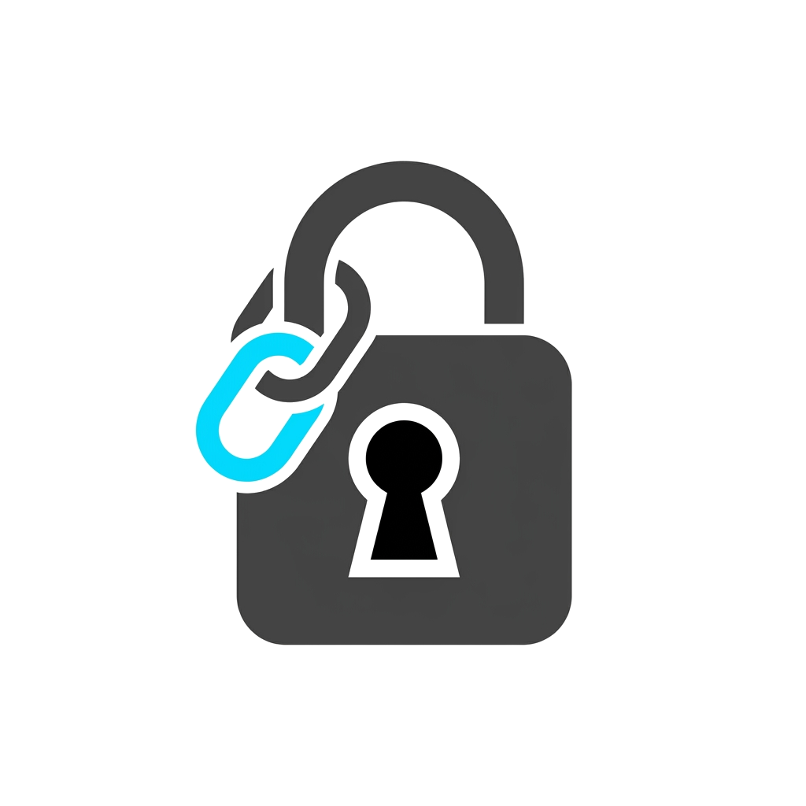

<div align="center">



# Encryption API

**A high-performance, secure URL and text encryption platform built with .NET 10, MongoDB, SQL Server, Redis, and Nginx.**


---

</div>

# What Encryption API Does

Sharing sensitive links and confidential messages over regular channels is risky. Once sent, anyone with access to chat logs or network traffic can view the content.

Encryption API provides an end-to-end encrypted sharing platform with zero-knowledge architecture. The server never stores your raw passphrase or plaintext URLs. All payloads are encrypted directly with modern cryptographic standards.

It scales easily using a multi-node architecture behind an Nginx load balancer, with SQL Server for link metadata, MongoDB for encrypted payloads, and Redis for distributed rate limiting and caching.

> [!NOTE]
> The full stack runs out of the box with Docker Compose, spinning up 3 load-balanced API nodes, Redis cache, and an Nginx reverse proxy.

---

# Key Features

* **Zero-Knowledge Encryption:** Data is encrypted using AES-256-GCM. Keys are derived with Argon2id using unique salts and IVs per link.
* **Burn on Read:** Links can automatically delete themselves immediately after the first successful decryption.
* **Expiration & Access Limits:** Configure custom expiry times and maximum allowed views per link.
* **Distributed Rate Limiting:** Redis-backed sliding-window rate limiting protects decryption endpoints from brute-force attempts.
* **Hashed IP Auditing:** Client IP addresses are securely anonymized using HMAC-SHA256 with a pepper before audit logging.
* **High Availability Architecture:** 3 stateless API nodes balanced via round-robin Nginx routing.

---

# Prerequisites

* **Docker & Docker Compose** (for running the full containerized stack)
* **.NET 10 SDK** (only if running locally without Docker)
* **SQL Server** instance
* **MongoDB** cluster or local instance
* **Redis** server

---

# Quick Start

### 1. Clone the Repository
```bash
git clone https://github.com/SamuelSivak/Encryption.git
cd Encryption
```

### 2. Configure Environment Secrets
Create a `.env` file in the `Encryption` directory based on `.env.example`:

```bash
cd Encryption
cp .env.example .env
```

Open `.env` and configure your credentials:
```env
MONGODB_CONNECTION_STRING=your-mongodb-connection-string
JWT_KEY=your-secure-jwt-secret-key-at-least-32-chars
IP_HASH_PEPPER=your-secure-ip-hash-pepper
```

### 3. Run with Docker Compose (Recommended)
From the `Encryption` directory, run:

```bash
docker compose up -d --build
```

Once running, the services will be available at:
* **Load Balancer (Nginx API)**: http://localhost:8080
* **API Interactive Docs (Scalar UI)**: http://localhost:8080/scalar/v1
* **Redis Cache**: localhost:6379

---

# Local Development Setup

If you prefer to run the API directly on your machine without Docker:

### 1. Restore & Build
```bash
cd Encryption
dotnet restore
dotnet build
```

### 2. Apply Database Migrations
Make sure your SQL Server is running, then apply migrations:
```bash
dotnet ef database update
```

### 3. Run the API
```bash
dotnet run
```

The API will listen on:
* **HTTP**: http://localhost:5207
* **Interactive Docs**: http://localhost:5207/scalar/v1

---

# API Endpoints

* **POST `/api/auth/register`** - Register a new user account.
* **POST `/api/auth/login`** - Authenticate and retrieve a JWT token.
* **POST `/api/links/create`** - Create a password-protected encrypted link (Requires JWT).
* **POST `/api/links/{shortCode}/decrypt`** - Decrypt a link payload using the passphrase.
* **GET `/api/links/my-links`** - Get all links created by the current user (Requires JWT).

---

# Technical Details

* **Framework:** ASP.NET Core Web API on .NET 10
* **Cryptography:** AES-256-GCM authenticated encryption + Argon2id key derivation (64 MB memory, 3 iterations, 4 parallelism)
* **Metadata Database:** Microsoft SQL Server with Entity Framework Core (master & read replica support)
* **Payload Database:** MongoDB Atlas / Replica Set with unique index enforcement
* **Caching & Rate Limiting:** Redis with atomic Lua scripting
* **Load Balancing:** Nginx Alpine with round-robin upstream distribution
